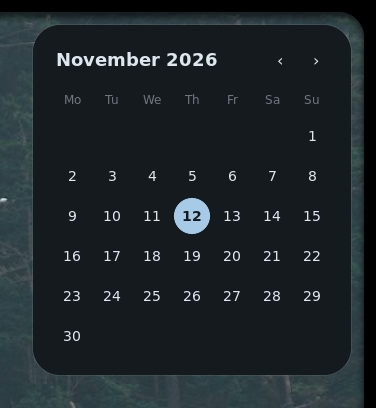

# vw

[](https://github.com/binarylinuxx/vw/actions/workflows/ci.yml)
[](LICENSE)

A C++23 Wayland widget library with its own Vulkan renderer, for bars,
docks, launchers, lock screens and windows.

**Docs:** [vw.zapzig.org](https://vw.zapzig.org) · **Examples:** [vw.zapzig.org/examples](https://vw.zapzig.org/examples/)



```cpp
#include <vw/vw.hpp>

int main() {
  vw::App app([](vw::Ui& ui) {
    ui.rectangle({.width = 240, .height = 48, .radius = 12, .color = vw::rgb(0x1e1e2e)});
    ui.surface({.width = 240, .height = 48, .anchor = vw::anchor::top});
  });
  return app.run();
}
```

## Build

```sh
nix build
# or
nix develop
cmake -S . -B build -G Ninja && cmake --build build
```

vw builds with clang. Link it with `find_package(vw)` and `vw::vw`.

## Nix

```sh
nix flake init -t github:binarylinuxx/vw   # a new CMake project using vw
```

In an existing flake, add the input `vw.url = "github:binarylinuxx/vw"` and the
overlay `vw.overlays.default`, then put `pkgs.vw` in `buildInputs`. See
[Install and build](https://vw.zapzig.org/start/installation/#in-a-nix-flake-project).

## License

BSD 3-Clause. See [LICENSE](LICENSE).
